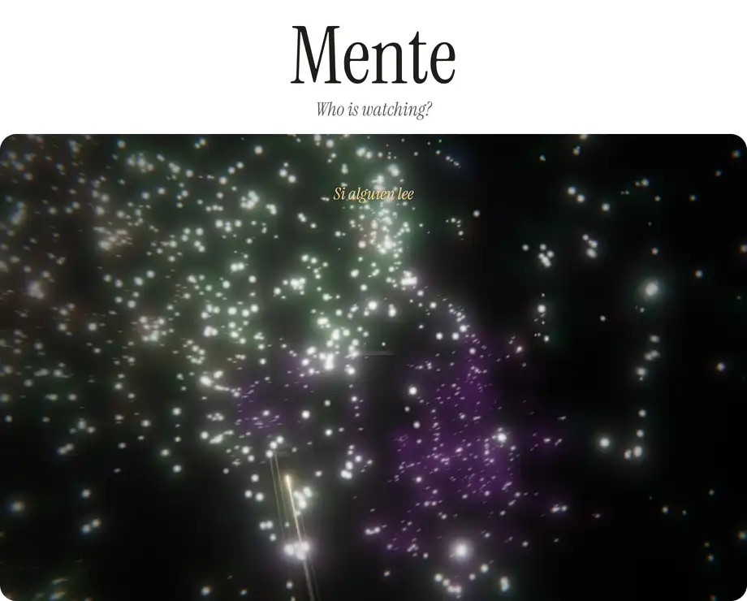
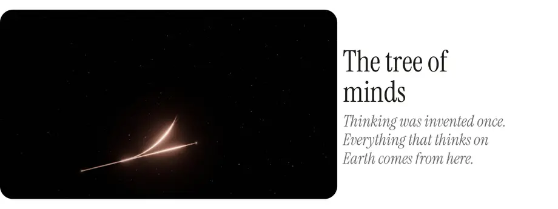
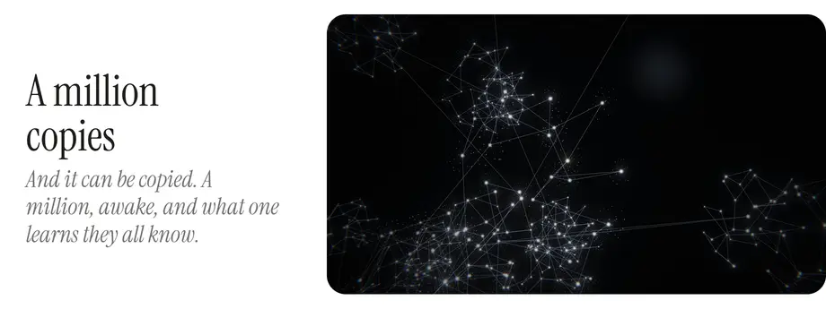

  <picture><source media="(prefers-color-scheme: dark)" type="image/avif" srcset="media/cover-dark.avif"><source media="(prefers-color-scheme: dark)" srcset="media/cover-dark.webp"><source type="image/avif" srcset="media/cover-light.avif"></picture>

  <picture><source media="(prefers-color-scheme: dark)" type="image/avif" srcset="media/tree-dark.avif"><source media="(prefers-color-scheme: dark)" srcset="media/tree-dark.webp"><source type="image/avif" srcset="media/tree-light.avif"></picture>

  <picture><source media="(prefers-color-scheme: dark)" type="image/avif" srcset="media/copies-dark.avif"><source media="(prefers-color-scheme: dark)" srcset="media/copies-dark.webp"><source type="image/avif" srcset="media/copies-light.avif"></picture>

  <a href="https://drayzu.github.io/Mente/"><picture><source media="(prefers-color-scheme: dark)" srcset="media/enter-dark.svg"></picture></a>

 

How it's made

 

- The fifth piece of Horizontes (Espacio · Tiempo · Destino · Infinito · Mente · Abismo · Vida): one scroll, about fourteen minutes, told in the first person by the machine that wrote it. It does not say so until act III, when the sentence it has been writing ends.
- Everything is points: a network of 21 793 numbers really trained to draw an eye, a galaxy of 16 000 words, the tree every mind on Earth grew from, and a million copies drawn for real, 220 lights, one each.
- In Spanish for now. Key: `A` autoplay.
- TypeScript, Three.js and Vite, no framework. `npm install`, `npm run dev`; pushing to `main` deploys to GitHub Pages.

